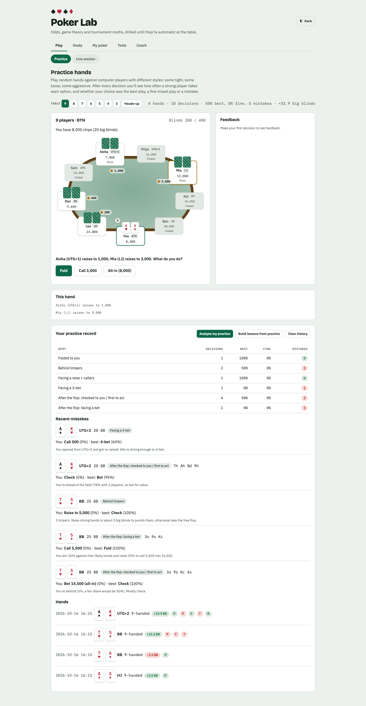
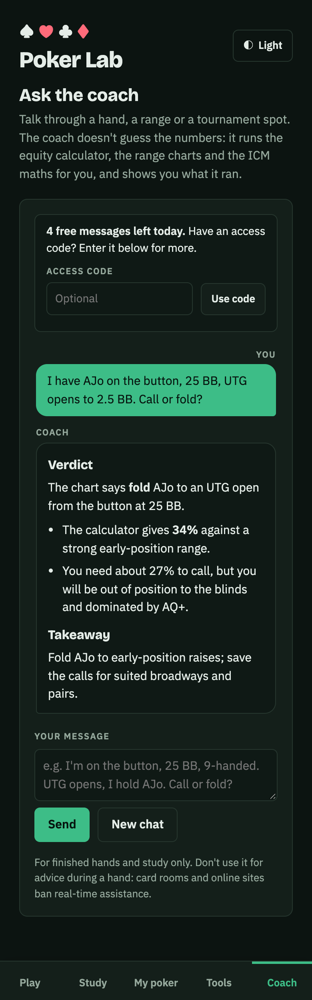

# Poker Lab ♠♥♣♦

An AI poker coach for Texas Hold'em tournament players. It analyses your hands, builds personalised lessons and teaches preflop ranges, so the maths becomes automatic at the table. You can also talk to a coach that **runs the real calculators** (equity, ranges, ICM, hand-history parsing) instead of guessing.

**Live:** https://pokerlab12.netlify.app

<p>
  
  
</p>

## What it does

| Area | Features |
| --- | --- |
| **Play** | Practice hands against bots with different styles (tight, loose, aggressive), scored after every decision as best / fine / mistake. Live session recorder for heads-up cash and tournament tables, with a rules-based coach. |
| **Study** | Preflop ranges by seat (folded to you, facing a raise, facing a 3-bet, facing an all-in) with a quiz, starting-hand equity chart, bet-sizing theory, and personalised lessons built from your own mistakes. |
| **My poker** | Import PokerStars / GGPoker hand histories (paste, `.txt`, `.zip`, or screenshots), stats and leak finder, comparison of your real decisions against the charts, hand write-ups with coach review, results tracker with ROI and profit graph, JSON backup/restore. |
| **Tools** | Equity calculator (hand vs hand / random hands), ICM calculator with call prices. |
| **Coach** | A chat agent that calls tools: `parse_hand_history`, `lookup_range`, `calc_equity`, `calc_icm`, `pot_odds`, `get_my_stats`. Every calculation it runs is shown as a chip under its answer. |

All your data stays in your browser (IndexedDB). Nothing is stored on a server, and there are no accounts. Use **My poker → Backup** to export or restore it.

## Architecture

```
Browser (Vite + TypeScript, no framework)            Netlify Functions (Node + TypeScript)
┌──────────────────────────────────────────┐        ┌───────────────────────────────────────────┐
│ src/features/*   one module per panel    │  SSE   │ /api/chat    coach agent loop (tools)      │
│ src/ai/client    streaming + errors      │◄──────►│ /api/lesson  lesson plan (JSON)            │
│ src/storage/db   IndexedDB + export      │        │ /api/vision  screenshot → hand history     │
│ src/ui/*         DOM helpers, table      │        │ /api/status  quota + availability          │
│                                          │        │                                           │
│ src/poker/*  ◄── pure TS, shared ───────────────► │ _lib/tools     tool dispatcher             │
│   cards · evaluator · equity · icm       │        │ _lib/openrouter  streaming + tool loop     │
│   ranges · handHistory · practice        │        │ _lib/ratelimit + guard  limits, origin     │
│   headsUp · coachEngine                  │        │ Netlify Blobs  rate-limit counters         │
└──────────────────────────────────────────┘        └──────────────────┬────────────────────────┘
                                                                       │ HTTPS, key stays server-side
                                                                       ▼
                                                              OpenRouter (cheap model, e.g. DeepSeek / Qwen)
```

- **One poker engine, two places.** `src/poker` has no DOM code. The browser uses it for the app, and the serverless functions import the same modules for the coach's tools, so the coach and the app can't disagree about a range or an equity.
- **The coach is an agent, not a prompt.** `/api/chat` streams from OpenRouter; when the model calls a tool the server runs it, feeds the result back, and continues (at most 6 rounds, 4 calls per round). Tool inputs are validated and outputs size-capped. Pasted text and tool results are treated as data, not instructions.
- **The key never reaches the browser.** The page only talks to `/api/*`.
- **Local-first data.** `src/storage/db.ts` is an IndexedDB store with an in-memory cache and change events.

## Run it locally

Requires Node 22+.

```bash
npm install
npm run dev          # the app only (study tools, ranges, practice, calculators work; AI shows "offline")
```

To run the coach locally you also need the serverless functions:

```bash
cp .env.example .env          # then put your OpenRouter key in .env  (never commit it)
npx netlify-cli dev           # app + functions on http://localhost:8888
```

Get a key at <https://openrouter.ai/keys>. Set a **credit limit on the key** in OpenRouter's dashboard so the worst case is bounded.

### Environment variables

| Variable | Default | Purpose |
| --- | --- | --- |
| `OPENROUTER_API_KEY` | – | **Required** for the coach. Secret. |
| `OPENROUTER_MODEL` | `deepseek/deepseek-v4.1-flash` | Chat / coach / lessons model. Any OpenRouter model with tool support, e.g. `qwen/qwen3.7-flash`. |
| `OPENROUTER_VISION_MODEL` | same as above | Model for screenshot import (needs image input). |
| `ACCESS_CODE` | – | Optional passcode. People who enter it skip the free-message limit. |
| `FREE_MESSAGES_PER_DAY` | `5` | Free AI messages per visitor (IP) per day, no code needed. |
| `RATE_LIMIT_PER_10MIN` / `RATE_LIMIT_PER_DAY` | `20` / `100` | Limits per IP for people with the access code. |
| `AI_DAILY_CAP` | `300` | Hard cap on AI requests per day across **all** visitors. |
| `ALLOWED_ORIGINS` | same origin only | Comma-separated extra origins allowed to call the API. |

## Deploy on Netlify (and add the key safely)

The site deploys from `main`. To turn the coach on:

1. Netlify → your site → **Site configuration → Environment variables → Add a variable**.
2. Add `OPENROUTER_API_KEY` with your key. Under scopes, tick **Functions** (and mark it **Contains secret values** so it can't be read back). Add `OPENROUTER_MODEL` and `ACCESS_CODE` the same way.
3. **Deploys → Trigger deploy → Clear cache and deploy site** so functions pick up the variables.

Secrets are never committed: `.env` and `.env.*` are git-ignored (only `.env.example` is tracked), and CI fails if anything that looks like an API key is committed.

## Protecting your credits

Strangers can try the coach from the live link, but they can't drain your account:

- **Free tier:** a few messages per visitor per day (`FREE_MESSAGES_PER_DAY`), keyed on a *hashed* IP, so raw IPs aren't stored. Counters live in Netlify Blobs, shared across function instances.
- **Access code:** friends you give the code to get higher limits (per 10 minutes and per day).
- **Global daily cap** across everyone (`AI_DAILY_CAP`), plus a per-instance burst guard.
- **Request caps:** body size, message count and length, tool rounds, and `max_tokens`; same-origin only.
- **Fails closed:** if the limiter can't be reached, AI requests are refused rather than allowed.
- Counting is read-then-write, so a coordinated burst can overshoot a little; the global cap and your OpenRouter key limit are the hard stops.

> Long requests (lesson building, screenshots) stream their output, which keeps the connection alive, but they are still subject to Netlify's function time limit for your plan.

## Tests and CI

```bash
npm test             # Vitest: poker logic, storage, backend (≈190 tests)
npm run typecheck
npm run test:e2e     # Playwright: every panel, key flows, mocked AI, phone layout
npm run shots        # screenshots of every panel, desktop + phone, light + dark → ./screenshots
```

- **Poker logic:** hand evaluator (every category, wheel, kickers, ties), equity vs known results (AA vs KK ≈ 82%, AKs vs QQ ≈ 46%, seeded), range notation and seat lookups, ICM, PokerStars and GGPoker hand-history parsing (synthetic fixtures), heads-up simulation, the practice engine (100s of random hands played to completion), the rules-based coaches.
- **Backend:** rate limiter, access code, origin checks, tool dispatcher, the agent loop against a mocked OpenRouter stream, and the real `/api/chat` handler.
- **GitHub Actions** (`.github/workflows/ci.yml`) runs a secret scan, typecheck, unit tests, build and the Playwright suite on every push and pull request.

## Project layout

```
src/poker/        pure poker engine (shared with the backend)
src/features/     one module per panel (practice, ranges, live, tracker, coach, ...)
src/ai/           browser client for /api/*
src/storage/      IndexedDB store, export/import
src/ui/           DOM helpers, table renderer
src/styles/       design tokens and layout (light + dark)
netlify/functions/  chat, lesson, vision, status + _lib (agent, tools, limits)
tests/unit/       Vitest      tests/e2e/   Playwright
scripts/          screenshot tool
```

## Notes

- Built with Claude (Anthropic). The original single-file app that this grew from is in the git history before the TypeScript rewrite.
- For reviewing finished hands and study only. Using any assistant during a hand breaks card-room rules and PokerStars' ban on real-time assistance.
